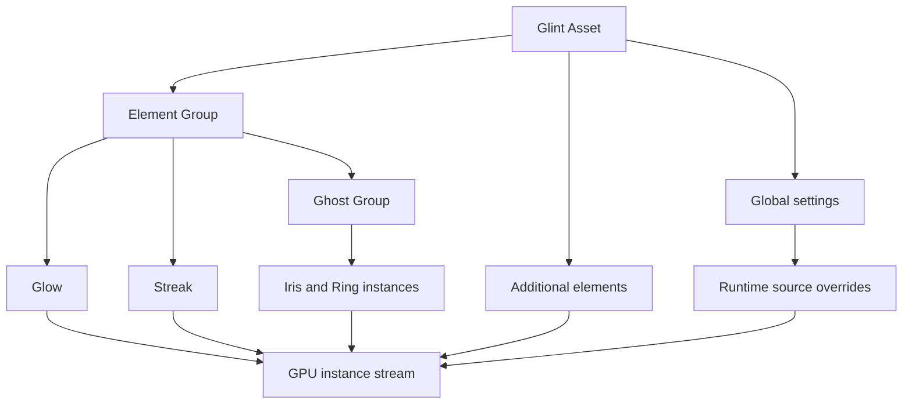

# 04 — Glint Element System

[← Documentation index](README.md)

## Core composition model

A Glint asset is an ordered set of Groups and Elements. Groups provide organization and inherited parameters (color multiplier, intensity, transform/placement offsets, enable state). An Element is a procedural primitive or textured sprite plus a compact set of parameters. The renderer compiles this composition into render-ready element instances per visible source.

## v1.0 rendering families and first-class authoring types

| Type | Controls | Rendering intent |
|---|---|---|
| **Glow** | radius, core, falloff, inner/outer tint, intensity | Procedural radial sprite / atlas |
| **Streak** | length, width, softness, orientation, taper, spread, offset | Thin anamorphic/linear glare, batched quad |
| **Starburst** | ray count, irregularity, size, taper, rotation, color | Several procedural rays or atlas with variable spokes |
| **Ghost / Iris** | axis position, aperture shape, sides, feather, opacity, dispersion | Discrete reflection artifacts |
| **Ring / Halo** | radius, thickness, arc, gradient, offset, tint | Hollow or curved lens artifacts |
| **Texture Sprite** | user texture, crop, size, rotation, UV, blend, color, animation frame support when affordable | Artistic/custom photographed artifacts |
| **Lens Dirt / Artifact** | mask texture, response to flare light, rotation, opacity, blending | Screen/lens-wide contamination; optimized shared handling |

These seven entries represent **rendering implementation families**, not the complete element picker. The artist-facing v1 palette contains 12 distinct familiar types and Texture Sprite, described exhaustively in [Optical Flares Reference](11-Optical-Flares-Reference-Audit.md) and [Element Parameter Schema](12-Glint-Element-Parameter-Schema.md). Shimmer, Glint, Spike Ball, Sparkle and Caustic should share GPU primitives where sensible but remain independent authoring choices.

A multi-ghost **Ghost Group** should have count/spread/variation/seed, but be decomposable to editable individual children when needed. For efficiency, each generated leaf remains an instance; it must not require one UObject Actor per ghost.

## Element parameter families

- **Identity:** stable element GUID, display name, type, enabled, locked, group ID/order.
- **Appearance:** intensity, RGBA/gradient, blend mode, size, aspect, softness, opacity, optional texture; HDR values and exposure behavior documented.
- **Placement:** axis factor (source↔screen center↔opposite), 2D offset in normalized viewport units, per-element rotation and pivot; aspect correction and resolution independence.
- **Dynamics:** optional intensity curve vs distance/viewport location/occlusion, deterministic shimmer/flicker, speed, seed, time offset.
- **Distortion:** affordable chromatic channel offset/dispersion, stretch, hue shift and UV distortion; only applied where meaningful.
- **Quality:** LOD importance, minimum on-screen size and fallback selection.

## Placement coordinate rules

Let `S` be the source in normalized screen coordinates and `C` be the screen center. Define a canonical axis coordinate `t`: `P = S + t * (C - S) + O` where `O` is authored 2D offset.

- `t=0`: element at projected source.
- `t=1`: element at center.
- `t=2`: element mirrored beyond center at the opposite source distance.
- Values beyond the endpoints are valid for creative ghost placement.
- Normalize by a documented reference dimension (e.g., shorter viewport edge) to avoid unintuitive wide-screen scaling.
- All rotations and offsets require consistent pixel vs normalized-unit display and a fixed conversion convention.

For directionally oriented elements, the placement/rotation options should include **Fixed Screen Rotation**, **Align to Source-Center Axis**, and **Per-Source Rotation Offset** when applicable.

## Animation contract

- Simulation and preview use the **same** deterministic time calculation from source time/seed; avoid global unseeded random state.
- Curves are continuous and evaluated without heavy editor-only logic at runtime; sampled/baked lookup tables when beneficial.
- Start/hold/fade/end envelope for transient sources; smooth edge entrance/exit; configurable occlusion fade.
- Flicker and shimmer are optional and per-element or group; avoid a separate ticking `UObject` for each animated element.

## Compositing constraints

- Establish explicit legal blend modes (additive, screen approximation, alpha/soft-add) based on chosen HDR pass, with artifact tests.
- Preserve stack ordering only where visual difference requires it; organize draw calls by shader/texture when blend algebra permits. UI order is not guaranteed to change additive-only rendering.
- Warn when Dirt/Artifact is an expensive full-screen option; do not apply an independent full-screen pass for every source.

## Reuse

Whole Glint assets are reusable. Element presets can be separate assets or editor library entries, but they must serialize using exactly the same element schema as regular flare content. Keep source assets and editor favorites separate from compiled runtime data.

## Behavior extension

All relevant object types support the compact, deterministic **Dynamic Triggering** contract defined in [13 — Behavior](13-Behavior-and-Trigger-System.md): typed inputs (border, center, angle, occlusion, distance, facing, time/noise), curves, operations, seed and preview visualization. Do not hardcode one-off border behavior inside individual shader types.
