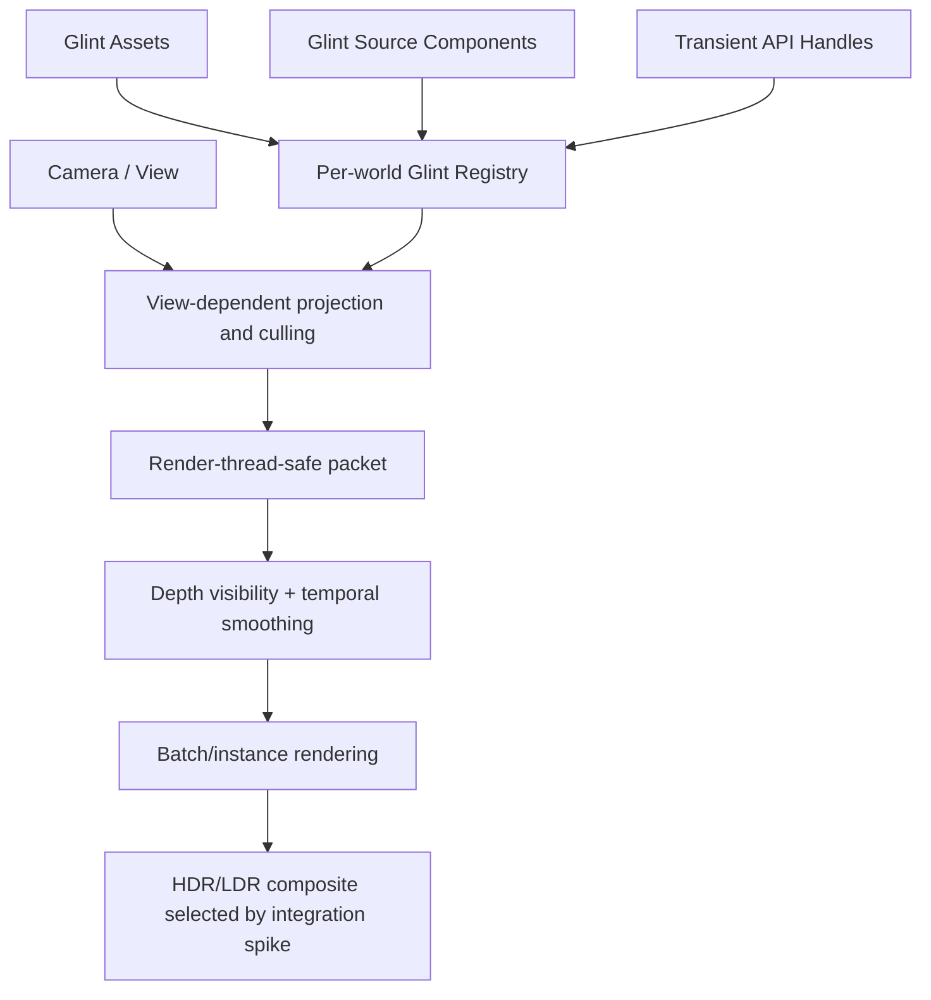

# 05 — Runtime Architecture and Public API

[← Documentation index](README.md)

## Proposed modules

| Module | Kind | Role |
|---|---|---|
| `Glint` | Runtime | Public types, asset/source components, registry, settings, runtime API and CPU preparation |
| `GlintRender` | Runtime | Scene View Extension, RDG/custom global shaders, GPU instance data, composite, occlusion |
| `GlintEditor` | Editor | AssetDefinition, Factory, Slate editor, preset browser, thumbnails, Details customization |
| `GlintTests` (optional) | Developer / test | Native automation tests, fixtures, benchmarks; alternatively test files inside Runtime/Editor modules |

Plugin root includes `Shaders/`, `Resources/`, `Content/` for original templates, and `Docs/`; fully packaged by Unreal's standard build pipeline. Use standard shader virtual directory mapping at module initialization, with startup ordering verified before shader compilation.

## Data ownership

### Glint asset

`UGlintAsset` stores serialized groups/elements, textures/curves and global settings in `USTRUCT` arrays or lightweight UObject subobjects only if required by editor lifetime/transactions. Stable GUIDs matter for editor selection, reordering, version-independent identity and deterministic preview.

One displayable source-relative **Glint Flare** composition per `UGlintAsset`; assets can be used by many authored **and automatically detected** sources with overrides. The source **does not own a private copy of the whole composition** unless explicitly baked as a new asset.

### Source component

`UGlintSourceComponent` is optional and can be attached to an Actor, LightComponent owner, socket or scene component. Exposed properties: asset, enable, intensity multiplier, color, priority, position/orientation mode, occlusion settings override and optional light intensity binding.

A source does **not** spawn one Actor per element and should not use a dedicated tick if the registry can batch updates. Source state handles BeginPlay/EndPlay and world teardown safely.

### Actor-free transient sources

Provide a runtime subsystem backed by a dense or pooled source record collection. `SpawnGlintAtLocation` / `SpawnGlintAttached` returns a generation-checked handle; `SetGlintIntensity`, `SetGlintTransform`, `StopGlint`, `IsGlintValid`. A handle must not become valid for a different instance after slot reuse.

Transient lifetime and animation can be controlled through spawn parameters, without game actors. Expose Blueprint and C++; do not require networking features in the rendering plugin.

### World subsystem

`UGlintWorldSubsystem` owns **authored** source registration and scene-local state. It assembles immutable per-view packets (source transform, asset reference, projected position, priority, random seed and animation parameters). Never expose thread-unsafe UObjects to arbitrary render-thread code. Copy/translate only required values to read-only POD/owned render resources.

### Scene View Extension

Owns per-view renderer attachment; filters irrelevant preview/world contexts, handles multiple views and ties GPU packets to view identity. Ensure shutdown/removal does not retain stale global references. Validate PIE worlds, Editor viewports, game preview and headless workflows.

## Runtime flow



## Source types

1. **World Point:** arbitrary position, optional orientation and source radius.
2. **Directional Sun:** scene directional-light orientation or explicit world direction, projected at a suitable far-field position with offscreen policy; no finite depth intersection assumptions.
3. **Attached/Light:** component transform, optionally input intensity and color with artistic remapping (not a claim of exact physical lens response).
4. **Transient:** world point with a deterministic lifetime envelope and optional attach target.

Avoid scanning the list of every Unreal Light Component as a substitute for **automatic HDR image detection**. Automatic flares come from sufficiently bright **rendered scene pixels**; authored world/directional lights remain a separate opt-in path. Both routes must be bounded and use the same view renderer.

## API sketch (contract, not compiled signatures)

```cpp
// Illustrative interface only. Exact UE 5.8 class/function signatures TBD.
FGlintHandle SpawnGlintAtLocation(UObject* WorldContext,
    UGlintAsset* Asset, FVector Location, FGlintSpawnOptions Options);
void SetGlintIntensity(UObject* WorldContext, FGlintHandle Handle, float Intensity);
void SetGlintLocation(UObject* WorldContext, FGlintHandle Handle, FVector Location);
void StopGlint(UObject* WorldContext, FGlintHandle Handle, float FadeSeconds);
bool IsGlintValid(UObject* WorldContext, FGlintHandle Handle);
```

Blueprint nodes must use clear display names and categories, have contextual defaults and reject asset-null/invalid handles cleanly. Avoid hidden level global assumptions.

## Resource lifetime

- Streaming/cooking references for all GPU textures, LUTs and shaders are explicit. Prevent per-frame blocking loads and runtime shader compilation.
- Per-view packet buffers should reuse allocations, use predictable capacity growth and avoid cross-world state leaks.
- Never keep raw UObject pointers on render thread without correct UE lifetime management and synchronization.
- Source unregister, world cleanup, shader reload and editor tab close must not crash or leak GPU resources.

## Engine conventions

Use UE editor-only module isolation, `BuildSettingsVersion::V7` and latest include ordering in the user target environment if required by target build setup. `.uplugin` is readable UTF-8 and package-ready; avoid undocumented project build dependencies.

## Dynamic source and element evaluation

Compile a `UGlintAsset` into compact per-type render-ready data; include typed [Dynamic Triggering](13-Behavior-and-Trigger-System.md) bindings and per-source deterministic seeds. Runtime sources are independent: the same asset can be attached to several lights without copying assets or sharing projection/occlusion history. Multi Iris expansion is into GPU instance records, not spawned actors/UObjects. Lens dirt illumination is per-view accumulation, not one full-screen dirt pass per light.

## Automatic camera system and assets (v1.0 requirement)

Add `UGlintLensProfile` (Content Browser **Glint Lens**) alongside existing `UGlintAsset` (**Glint Flare**). The lens specifies HDR sensitivity, candidate extraction, field ghost/streak operators, element template mapping, per-camera surface dirt, optical style, quality caps and optional CineCamera lens links. A **project default** makes this active for eligible game views without adding Actors. `UGlintLensComponent` and optional Glint Lens Volume provide overrides with deterministic precedence; the exact view assignment API needs the R0/R1 spike.

Automatic source records are built on GPU from bright input via threshold → tile reduction → region/peak merge → top-K → temporal match. The image-space flare field is also GPU-driven. Automatic records are *not* world Actors; they can feed the same element descriptor consumer as manual records. View-specific candidate history/resources should be owned/managed by the renderer view state, not accidentally stored on the World Subsystem as global pixel history.

For shared render packets, tag sources `ImageCandidate`, `WorldPoint`, `WorldDirectional`, `ExplicitScreen`. Only world-derived records require depth-source occlusion; automatic records are already image-visible at their sampled pipeline stage. Apply a visible screen-space dedup policy. See [22](22-HDR-Highlight-Detection.md), [23](23-Camera-Lens-Profile-and-UX.md), [24](24-Automatic-and-Authored-Rendering.md).
