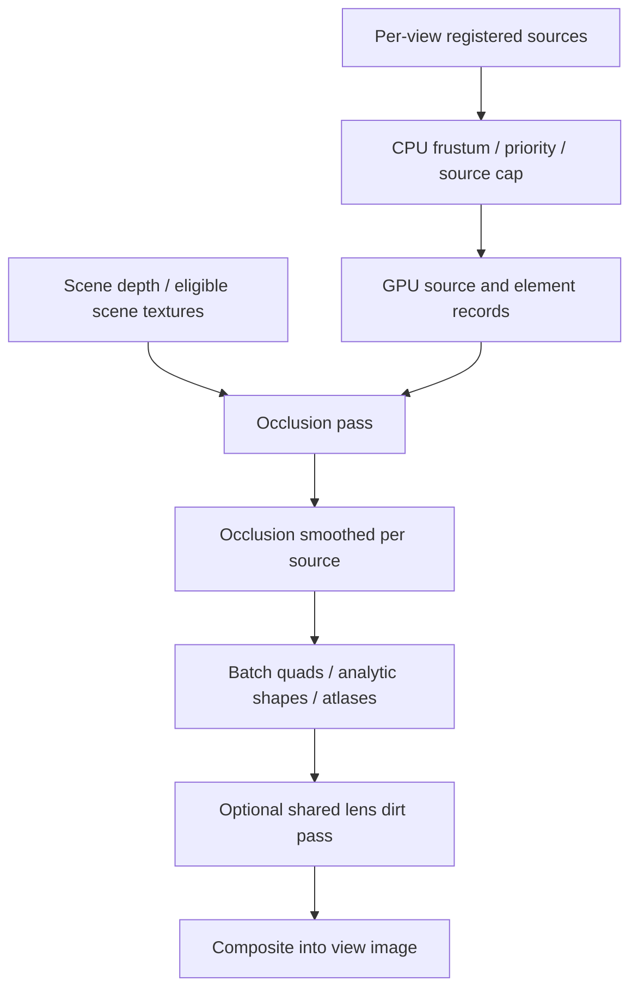

# 06 — GPU Renderer, Occlusion and Integration

[← Documentation index](README.md)

## Technical recommendation

Use a plugin-owned Render Dependency Graph (RDG) implementation that draws flare element instances into an appropriately sized render target and composites them into the view. Use procedural shaders, shared textures/atlases and **instancing/batched draws**, not one translucent component and draw path per authored element.

`FSceneViewExtensionBase` and `ISceneViewExtension::SubscribeToPostProcessingPass` in UE 5.8 provide a documented route for hooking post-process work. **This does not prove that every required texture, blend location or depth resource is exposed in a shipping-safe way**; confirm with the first renderer spike. The earlier third-party Froyok approach modified engine code and is a technical reference, *not* an acceptable dependency for this product.

## Proposed renderer sequence — authored branch (expanded automatic pipeline in document 24)

### Pass architecture

1. **Visibility:** project source per camera, reject behind-camera/nonfinite/unimportant sources, enforce caps.
2. **GPU visibility:** compare projected source depth against opaque/masked scene depth; configurable multi-sample kernel for soft covering; no CPU readback.
3. **Build instance stream:** position, shape ID, radius/ratio, rotation, tints, UVs, opacity, source visibility and animation scalar; upload in compact buffers.
4. **Rasterize:** batch by compatible shader mode/texture/quality. Favor procedural analytic shapes for Glow/Ring and quads/atlas for complex ghosts/textures.
5. **Composite:** place effect at the earliest validated pass that yields desired scene integration, exposure and antialiasing, without modifying engine files.

### HDR and pass selection — mandatory spike

UE5.8 defines post-process pass enum entries (e.g., `BeforeDOF`, `AfterDOF`, `MotionBlur`, `Tonemap`, `FXAA`). The contemporary API has a **view-aware callback**; the older non-view callback is deprecated and must not be used. `Tonemap`-associated timing is not a blanket promise that a callback runs at the desired HDR point. Verify live scene textures, eye adaptation, TSR, bloom interaction and the final override output behavior per path.

**Initial preference:** integrate **before tone mapping** for HDR-consistent flare light, with a well-defined response to exposure and bloom. If native callbacks cannot give correct pre-tonemap behavior without unacceptable hacks, choose a supported compositing compromise and clearly label it; do not silently require engine patches.

## Occlusion design

- For each visible *point* source, get projected UV and expected depth. Sample scene depth and compare with bias/soft-radius settings. An opaque/masked occluder nearer than the source reduces visibility.
- Soft occlusion uses a bounded sample footprint around projected source and optionally source angular radius; 1-point sample is a low-cost option; 5–9 taps is a candidate higher-quality option, not a mandated fixed count.
- Apply temporal smoothing to the **occlusion scalar**, not to the position of each flare element; response up/down can have distinct rates to prevent light leaking or abrupt disappearance.
- Clamp out-of-bounds/behind-camera depth queries. Use explicit source-edge fade to avoid violent flare jumps at the sides of the viewport.
- For a directional source, depth comparison must use suitable far-field semantics, not the point-source distance blindly.
- Respect scene depth conventions (reverse-Z if applicable), dynamic resolution, viewport subrects and temporal jitter; these must be verified against target 5.8 code, not guessed.

### Known limitations

Standard scene depth does **not** perfectly represent translucent particles, transparent panes, emissive fog and arbitrary volumetric effects. Default v1 occlusion should promise reliable opaque/masked behavior only. Optional manual occlusion override/camera trace fallback may help special cases but is **not** the primary path.

## Screen-space stability

- Perform source projection per view with stable matrices and correct viewport offsets.
- Preserve intended interpolation under TAA/TSR and during fast camera movement; render sharp skinny streaks at adequate resolution or use analytic antialiasing.
- Avoid view-family-global cache keys that cause multiple players, reflection captures or editor previews to inherit another view's visibility.
- Source movement, camera cut and view resize need correct temporal-history invalidation.
- Render only useful output. When **automatic mode is disabled** and there are no authored sources, bypass flare work. When automatic is **enabled**, a bounded HDR detection pass is still required even if no authored sources exist; early-out further field/candidate work if no eligible highlights.

## Native post-process coexistence

The plugin is a **separate authored flare system** and must not modify native UE lens flare settings or bloom behind the user's back. Warn when both are enabled and describe the result. Provide clear controls for disabling the plugin per view/world without altering the user's level settings. Confirm view flags behavior for editor previews and standalone.

## Spike acceptance

Before implementing the full editor, demonstrate in a stock installed UE5.8 build, **without modifying Engine/**:

1. External plugin shader compiles and runs in editor/PIE/packaged Win64.
2. Moving world-space source produces a GPU batched procedural glow and streak.
3. Opaque geometry occludes smoothly using scene depth, with correct moving camera behavior.
4. HDR/exposure, bloom/TSR, viewport resize, dynamic resolution and PIE world isolation have documented outcomes.
5. Scene View Extension properly releases GPU resources and does not crash upon plugin/editor shutdown.

**If #1 or #2 fails, revisit architecture immediately.** Do not build months of editor tools on an unsupported renderer assumption.

## Required new automatic pipeline

Source detection is no longer limited to the manually registered world-source flow above. Extract a **pre-Glint, pre-tonemap HDR** signal; normalize pre-exposure; evaluate user threshold/contrast/area settings; create a reduced-resolution bright field for warped/reversed ghosts and streaks; concurrently compute a bounded GPU top-K candidate list to drive actual Glint element compositions. Compose both with manually registered source elements and shared per-view lens dirt, with an explicit policy avoiding double application. This is an **R0 acceptance gate**, not an optional future feature. No synchronous GPU readback. See [22](22-HDR-Highlight-Detection.md) and [24](24-Automatic-and-Authored-Rendering.md).

Image candidates need **no fake scene-depth queries**; their existence is defined by the bright rendered input. Authored point/directional sources continue using the scene-depth strategy described earlier. Native UE image-based lens flares and bloom can coexist but must be flagged to avoid accidental doubled looks. The Glint-owned HDR bright-pass should function even with native Bloom disabled.

### Additional spike acceptance

Prove that a bright emissive surface produces a Glint ghost/streak with **zero registered Glint sources** in PIE and cooked Win64. Prove that a bounded automatically detected highlight can drive a procedural Glint iris/glow without Actor spawning, and that camera exposure and a hard camera cut do not corrupt candidate identity. Profile the detection work separately from authored elements. See [28](28-Automatic-Mode-Testing-and-Release-Gates.md).

## Cross-engine renderer research notes

- Unity's screen-space lens flares can sample its Bloom mip chain; UE5.8 **may not** expose equivalent resources at Glint's appropriate stage. Compare a reused image pyramid with a guaranteed independent Glint HDR extraction path, including when engine bloom is disabled.
- Keep *source visibility* distinct from *sensor-space ghost compositing*. Source partial occlusion may affect shapes/strength, but foreground occluders should not simply cut hard holes through projected camera ghosts. CRYENGINE offers an artistic source-shaped occlusion precedent.
- Brightness reduction must preserve **peak luminance + integrated energy/coverage**, not only averages: protect tiny distant highlights without promoting entire bright walls to full complex sources.
- Combined candidate extraction/field/composite cost includes GPU memory traffic and intermediate texture formats. Check R11G11B10F vs RGBA16F where positive-only accumulation and blending semantics permit.
- Keep first-order physically inspired transforms compatible with authored edge warps; do not assume paraxial approximation accurately captures wide angles.
- See [36](36-Rendering-Papers-and-Architectural-Lessons.md) and [37](37-Cross-Engine-Findings-and-Prototype-Gates.md).
